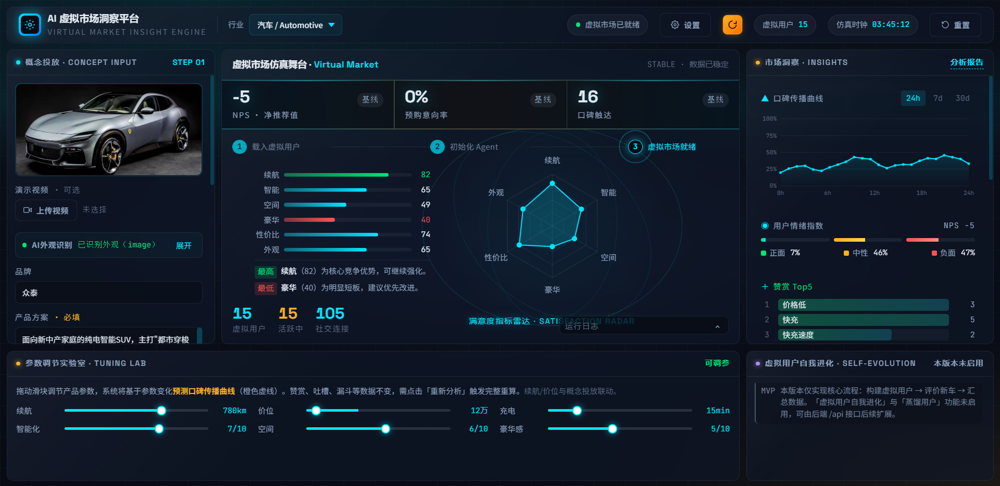
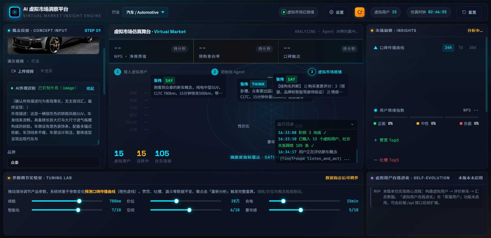

# VMIE（Virtual Market Insight Engine）

原用于参加TRAE AI创造力大赛的，没入复赛；其实这个方向也是我很早之前就想尝试，只是一直找不到一个动机。洞察引擎不仅可以对产品观测，也可以变通为传播力模拟，例如一篇推文、一个事件等。目前只是个Demo，只跑通基本功能，有兴趣的同学接力吧。

基于LLM的 Agent 架构\TinyTroupe 和多模态视觉模型的虚拟市场洞察引擎，让数千个具有不同画像的 AI 虚拟用户在同一市场环境中自主决策、社交传播、形成口碑。通过观察它们的群体行为，预测真实市场反应。虚拟用户会根据现实世界里的市场信息，通过更新记忆流、进行反思、行动意向等自我进化。



虚拟用户分为两种：
（1）模拟实际场景，设定虚拟用户的身份、行为、喜好、信仰等特征，由LLM生成虚拟用户。
（2）利用合规的脱敏后的行业用户数据，包括社交媒体、评论、点赞收藏等行为数据，蒸馏成“真实的”虚拟用户。

虚拟用户行为：
（1）在虚拟市场中，这些用户看到新品的概念、参数、外观等特征后，会作出自主行为，包括：想法、分享到社交媒体、告诉身边朋友、查阅相关资料等，最后作出行为决策（试用、购买等）并进行结构性反馈。
（2）虚拟用户会接收现实世界里的行业新闻、动态等，这些信息会影响和改变其喜好和信仰。



主要流程是：

- 生成虚拟用户画像
- 输入产品概念并触发虚拟用户评价和行为
- 聚合输出基础洞察结果
- 可选上传图片或视频，生成客观外观描述后参与评价

## 运行环境

- Python 3.10+
- 本地依赖见 [requirements.txt](requirements.txt)
- 根目录使用 [.env.example](.env.example) 作为环境变量模板

## 快速启动

1. 安装依赖

```bash
pip install -r requirements.txt
```

2. 复制环境变量模板并填写实际密钥

```bash
copy .env.example .env
```

3. 启动后端

```bash
python app.py
```

默认服务地址：`http://127.0.0.1:5000`

前端页面：

- [ui.html](ui.html)
- [settings.html](settings.html)

## 目录说明

- [app.py](app.py)：Flask 后端入口
- [simulation.py](simulation.py)：虚拟用户生成与评价逻辑
- [aggregator.py](aggregator.py)：评价结果聚合
- [vision.py](vision.py)：图片/视频视觉描述
- [personas](personas)：已保存的人设数据
- [TinyTroupe](TinyTroupe)：项目使用Microsoft TinyTroupe 模拟引擎

## Demo

- http://vmi.xiaojuai.com